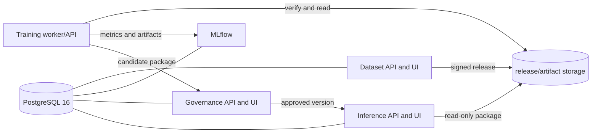

# Local platform integration audit

**Audit date:** 2026-11-22
**Milestone:** local research development only
**Repositories inspected:** `Medical_Dataset_Pipeline`, `medical_imaging_model`,
`MLOps-and-model-governance`, and `Medical_Inference_Application`

This audit is based on the checked-out source, tests, packaging metadata,
database code, Docker files, launchers, CI, and integration documentation. It
does not authorize or require an AWS deployment. Production OIDC, DNS, TLS,
CIDRs, and cloud budgets are outside this milestone.

## Executive assessment

The four repositories already implement most of their individual business
functions and a useful cross-repository contract. The verified synthetic test
can publish a signed dataset fixture, load it in Model Engineering, train and
export both PyTorch and TensorFlow classifiers, register and independently
approve the package, run inference, and persist dataset/model lineage. Seven
cross-repository tests pass.

The repositories do not yet form the requested local application. The current
research launcher starts the three GUIs and APIs, while the existing Compose
file starts MLflow, PostgreSQL, and MinIO. These paths are separate. Dataset run
submission requires AWS Batch, local release registration accepts only S3
receipts, Model Engineering does not expose a durable local job interface, and
the governance service stores its registry in SQLite instead of the shared
PostgreSQL server. The existing acceptance suite also bypasses real ingestion,
EDA, a live MLflow server, PostgreSQL, and container networking.

## Current architecture and reusable components

| Repository | Authority | Existing reusable implementation | Current integration boundary |
| --- | --- | --- | --- |
| Dataset Pipeline | Raw data, catalogue, splits, reports, published releases | Source adapters, validation, three-level EDA, duplicate/leakage checks, task exporters, portable v2 signed receipts, SQLAlchemy/Alembic catalogue, FastAPI, Streamlit | `GET/POST /api/v1/published-releases`; portable receipt and task manifests |
| Model Engineering | Readers, training, evaluation, checkpoints, model packages | Strict receipt/manifest/asset reader, PyTorch and TensorFlow engines, classification/segmentation/detection paths, MLflow logging, inference export | Shared dataset reference in; model package and candidate submission out |
| MLOps and Governance | Experiment metadata, candidate registry, approval and deployment eligibility | MLflow helpers, package checksum validation, state machine, independent reviewer rule, FastAPI and Streamlit | Candidate registration and approved-version APIs |
| Inference | Approved model loading, predictions, history and lineage | Governance lookup, package re-verification, framework runtimes, upload validation, visualization UI, SQLAlchemy SQLite/PostgreSQL audit store | Approved model API in; structured prediction and lineage records out |

The dataset repository correctly keeps image bytes outside SQL. The model
repository preserves release IDs, receipt digests, split digests, sample IDs,
and task annotations. Governance re-verifies the package at approval and
deployment transitions. Inference queries governance for the exact approved
version and records the experiment and dataset lineage.

## Shared contracts status

`medical-imaging-platform-contracts` exists as a versioned Python package and
JSON schemas under `Medical_Inference_Application/packages/contracts`. The
three consumers pin the same immutable Git commit and use shared dataset,
candidate, inference-request, prediction, and lineage models.

The old local `Medical_Inference_Application` directory is a contracts-only
checkout whose configured remote no longer exists. It is not a fifth working
service. Hosting the canonical contracts inside the inference repository works
for the present integration branch, but gives the inference application
ownership of schemas used by every repository. Before the first stable platform
release, publish the package from a dedicated contracts repository or explicitly
ratify the inference repository as its owner, tag a semantic version, and pin
that tag or package digest in all four repositories. Until then, the immutable
commit pin is the approved local-development mechanism.

## Dependency and runtime findings

- All Python services target Python 3.10. Keep independent virtual environments
  or Docker images; TensorFlow, PyTorch, Streamlit, and API dependencies should
  not be forced into one interpreter.
- The model and inference repositories pin NumPy 2.0.2 and their framework
  versions. The dataset repository has broader ranges. Container boundaries
  prevent those ranges from destabilizing training.
- Model Engineering has two MLflow logging paths. They record useful lineage but
  should be consolidated around one run context and configured tracking URI.
- The MLOps Compose draft already provides PostgreSQL 16, MLflow 2.19, and
  MinIO. Governance itself uses raw SQLite, so this is not yet a shared metadata
  platform.
- Dataset Pipeline and Inference already support PostgreSQL. They own distinct
  schemas/migrations and should retain that ownership.
- The loopback research identity adapter is intentionally development-only.
  Container-to-container requests will not appear as loopback, so Compose needs
  an isolated local-auth mode guarded by `PLATFORM_ENV=local` and host ports
  bound to `127.0.0.1`. Production authentication paths must remain unchanged.
- The dataset API's run endpoint is AWS-Batch-specific. Its local background EDA
  runner already exists and should be exposed through a local execution adapter,
  selected by configuration.

## Proposed local workspace

Keep sibling checkouts and their Git histories:

```text
workspace/
  medical_dataset_pipeline/
  medical_imaging_model/
  MLOps-and-model-governance/
  medical-imaging-inference-platform/
  .local-platform/                 # ignored runtime state only
    datasets/
    releases/
    artifacts/
    predictions/
```

The platform Compose definition should live under
`MLOps-and-model-governance/infra/local/` because that repository already owns
the local MLflow/PostgreSQL/MinIO stack. Build contexts are supplied through
environment variables pointing at sibling checkouts, so no repository imports
another repository's source tree. The existing non-container research launcher
remains useful for quick debugging.



## Storage and database design

Use one PostgreSQL server with separate databases and credentials:

| Database | Owner | Contents |
| --- | --- | --- |
| `medtriage` | Dataset Pipeline | dataset catalogue, releases, reports and pipeline runs |
| `mlflow` | MLflow | experiments, runs and MLflow model-version metadata |
| `governance` | MLOps | evaluations, candidates, decisions and audit events |
| `inference` | Inference | prediction records, model/dataset lineage and errors |

Sharing a server reduces local overhead; separate databases and migrations keep
ownership clear. Services must communicate through APIs/contracts rather than
writing another service's tables.

For the first local milestone, bind-mounted filesystem storage is sufficient:
raw/processed datasets are writable only by Dataset Pipeline, releases are
immutable after publication, training writes staging model packages, Governance
publishes approved packages, and Inference mounts approved packages read-only.
MinIO remains available for S3-behavior tests and MLflow artifacts, but ordinary
local execution should not require copying every image into MinIO.

## Proposed Compose services

| Service | Purpose | Health gate |
| --- | --- | --- |
| `postgres` | Four logical databases/users | `pg_isready` plus initialization completion |
| `minio`, `minio-init` | MLflow/S3-compatible artifacts | bucket probe |
| `mlflow` | Experiment tracking and artifact proxy | `/health` |
| `dataset-migrate`, `dataset-api`, `dataset-ui` | Catalogue and data workflows | migration completion, `/healthz`, Streamlit health |
| `training-api`, `training-worker` | Durable experiment submission and execution | API health and worker heartbeat |
| `governance-migrate`, `governance-api`, `governance-ui` | Registry and approval | migration completion and `/health` |
| `inference-migrate`, `inference-api`, `inference-ui` | Approved-model prediction | `/ready` and Streamlit health |

The training worker should be the only general service image containing both
deep-learning frameworks. API and UI images stay small. A database-backed job
table and subprocess worker are enough for local use; no new queue product is
needed for this milestone.

## End-to-end local workflow

1. Register or ingest a small licensed fixture through Dataset Pipeline.
2. Execute validation, EDA, duplicate/leakage analysis, task exports, and frozen
   splits; persist reports and run state.
3. Publish an immutable local portable-v2 receipt and register it in the dataset
   catalogue. The same publisher continues to support S3 separately.
4. Submit an experiment by release ID. Model Engineering retrieves the receipt
   through the dataset API, verifies signature and all referenced digests, then
   streams assets from the shared read-only release mount.
5. Log config, metrics, checkpoints, evaluation, Git revision, receipt digest,
   and manifest digests to MLflow.
6. Export a complete model package and submit its shared candidate contract to
   Governance with an idempotency key and MLflow run ID.
7. A different local actor reviews and approves the candidate. Governance
   re-verifies package bytes and marks one version deployment-ready.
8. Inference discovers that exact approved version from Governance, verifies the
   package, runs the recorded preprocessing and runtime, visualizes output, and
   saves prediction lineage in PostgreSQL.

## Required code changes by repository

### Dataset Pipeline

- Add a configured local execution backend alongside the current AWS Batch
  backend; expose existing ingestion/EDA jobs through durable run records.
- Permit `file://` release receipts only in explicit local mode and only beneath
  the configured release root. Preserve the S3 prefix restriction elsewhere.
- Add a small licensed/synthetic fixture command that performs actual ingestion,
  EDA, split/export, report generation, publication, and catalogue registration.
- Add Compose Docker targets and migration health gates without changing AWS
  Terraform or production authentication.

### Model Engineering

- Add a small training service/job command accepting a verified release
  reference and experiment configuration.
- Consolidate MLflow lifecycle handling; always log receipt/manifest digests,
  preprocessing, class mapping, environment, evaluation and package checksum.
- Add remote dataset-API discovery while keeping direct verified-receipt input.
- Emit the shared candidate contract and MLflow run ID after successful export.

### MLOps and Governance

- Generalize persistence from raw SQLite to PostgreSQL while retaining SQLite
  for unit tests; add owned migrations.
- Extend the existing Compose stack into the central local stack and initialize
  separate databases/users.
- Link candidate/evaluation records to MLflow run IDs without making the MLflow
  registry the approval authority.
- Add explicit local-only identities and preserve independent reviewer checks.

### Inference

- Finish the existing port-offset launcher changes, then keep it as the fast
  non-container option.
- Add PostgreSQL migration/startup wiring to Compose and use Governance over the
  internal network.
- Add an automated UI/API smoke workflow that uploads a fixture, verifies the
  visualization response, and checks persisted lineage.
- Update the contracts documentation to reflect the canonical package decision.

## Milestones and acceptance criteria

| Milestone | Acceptance evidence |
| --- | --- |
| 0. Audit and contract freeze | This audit accepted; one versioned contracts source and compatibility matrix |
| 1. Local data foundation | `docker compose up` yields healthy PostgreSQL, MinIO, MLflow, migrations and APIs on loopback |
| 2. Dataset-to-training | Actual fixture ingestion/EDA publishes a receipt; both frameworks train from the verified release; MLflow contains full lineage |
| 3. Training-to-governance | Exported package is registered idempotently; self-approval fails; independent approval succeeds; altered bytes fail |
| 4. Governance-to-inference | Only the approved version loads; upload returns visualization and persisted prediction lineage |
| 5. Full acceptance | One command runs the fixture lifecycle and asserts traceability from prediction to source release; restart preserves state |

Failure tests must cover a corrupt receipt/manifest/asset, leakage, failed EDA,
interrupted training, duplicate registration, changed package, self-approval,
unapproved/archived model, incompatible preprocessing, and API retry.

## Verified today

The cross-repository synthetic suite completed with **7 passed** using the
actual dataset publisher, model readers/trainers/exporters, governance routes,
and inference routes. It covers all three dataset task contracts, PyTorch and
TensorFlow classification, detection negatives, tamper rejection, independent
approval, package mutation rejection, and archived-model rejection.

This evidence validates the core contracts and business transitions. It does
not validate real ingestion/EDA, live MLflow, PostgreSQL persistence, Compose
networking, GUI rendering, production authentication, AWS, clinical quality, or
production scale. Those claims remain pending the milestones above.
