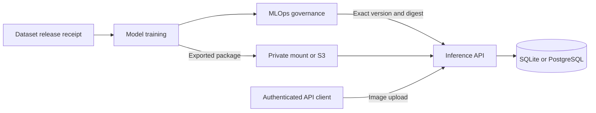

# System architecture

The dataset pipeline publishes verified release receipts. Training consumes these receipts and writes a model package. MLOps governance verifies the package and grants explicit approval. The inference API resolves a specific approved version and verifies the package digest before loading its framework export.

The implemented inference boundary lives in `src/medical_imaging_inference`. `app.py` owns HTTP routing and currently invokes the framework runtimes. `security.py` validates OIDC bearer tokens and verifies mounted packages. `preprocessing.py` validates input contracts and transforms images. `audit.py` stores prediction metadata and scopes reads to the requester or administrators.

## Deployment components

The [Streamlit workstation](../../apps/frontend/README.md) uses authenticated
FastAPI endpoints. Registry discovery, artifact retrieval, model caching,
preprocessing, output decoding, and persistence sit behind the API.
The [AWS deployment](../deployment/aws-deployment.md) uses EC2, an existing
HTTPS ingress and PostgreSQL service, and private S3 artifact access.

The governance API exposes exact approved-version lookup. Registry
discovery maps published MLflow versions to that identity. S3 packages
use the governance-approved digest as the publication prefix.
